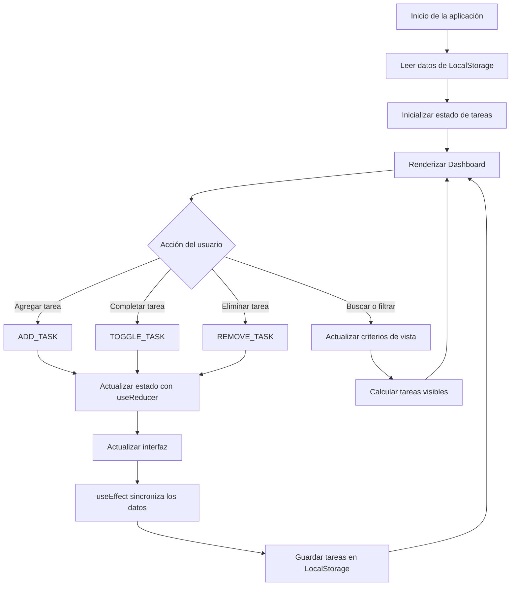
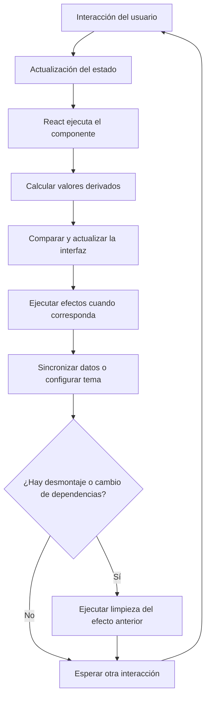

# Dashboard de Gestión de Tareas con React Hooks

## 1. Descripción del proyecto

El Dashboard de Gestión de Tareas es una aplicación web desarrollada con React y Vite que permite organizar actividades de forma interactiva. El usuario puede registrar tareas, completarlas, eliminarlas, buscarlas, filtrarlas y ordenarlas. Además, la aplicación presenta estadísticas de avance y permite cambiar entre el tema claro y oscuro.

El proyecto aplica Hooks de React para gestionar el estado, compartir información entre componentes, ejecutar efectos secundarios, persistir datos y evaluar optimizaciones de renderizado.

## 2. Objetivos

### Objetivo general

Desarrollar un dashboard interactivo que aplique diferentes Hooks de React para administrar tareas y mantener una estructura de código organizada.

### Objetivos específicos

- Administrar las tareas mediante `useReducer`.
- Utilizar `useState` para controlar los estados locales de la interfaz.
- Compartir el tema visual mediante `useContext`.
- Sincronizar datos con LocalStorage utilizando `useEffect`.
- Aplicar `useMemo` y `useCallback` para reducir trabajo innecesario cuando corresponda.
- Utilizar `useRef` para acceder al campo de entrada de tareas.
- Crear un Hook personalizado para reutilizar la lógica de persistencia.
- Comprobar el funcionamiento con ESLint, la compilación y React Developer Tools.

## 3. Tecnologías utilizadas

- React
- Vite
- JavaScript
- CSS
- React Hooks
- LocalStorage
- ESLint
- React Developer Tools

## 4. Funcionalidades del sistema

1. Registrar tareas con título, prioridad y fecha límite.
2. Marcar tareas como completadas o pendientes.
3. Eliminar tareas.
4. Buscar tareas por su título.
5. Filtrar tareas por estado.
6. Ordenar las tareas según el criterio disponible en la interfaz.
7. Visualizar estadísticas de tareas y progreso.
8. Cambiar entre tema claro y oscuro.
9. Conservar las tareas y preferencias mediante LocalStorage.

## 5. Diagrama de flujo del estado

El siguiente diagrama representa el flujo general de las operaciones del dashboard.



### Explicación

El estado inicial se obtiene de LocalStorage y se utiliza para inicializar las tareas. Cuando el usuario realiza una operación, `useReducer` procesa la acción y actualiza el estado. React vuelve a renderizar los componentes que necesitan reflejar los cambios. Los criterios de búsqueda, filtro y ordenamiento determinan qué tareas se muestran.

## 6. Diagrama del ciclo de renderizado



### Explicación

React vuelve a ejecutar los componentes cuando cambian sus estados o propiedades relevantes. `useMemo` permite reutilizar resultados calculados si las dependencias no cambian. `useCallback` permite conservar referencias de funciones. Los efectos se ejecutan según sus dependencias y pueden incluir una función de limpieza para liberar o revertir recursos.

## 7. Justificación técnica de los Hooks

### 7.1. useState

Se utiliza para manejar estados locales, como los campos del formulario, la búsqueda, los filtros y los criterios de ordenamiento.

**Justificación:** permite actualizar una parte concreta de la interfaz sin tener que administrar todo el estado de la aplicación en un solo objeto.

### 7.2. useReducer

Se utiliza para centralizar las operaciones principales de las tareas, como agregar, completar y eliminar.

**Justificación:** las operaciones se organizan en acciones y un reducer. Esto facilita mantener la lógica de actualización en un lugar definido y hace que el comportamiento sea más fácil de revisar y probar.

### 7.3. useContext

Se utiliza para compartir el tema visual entre los componentes que lo necesitan.

**Justificación:** evita tener que pasar la propiedad del tema manualmente por varios niveles de componentes.

### 7.4. useEffect

Se utiliza para sincronizar el estado con LocalStorage y aplicar cambios relacionados con el tema visual.

**Justificación:** permite sincronizar React con recursos externos. Las dependencias deben representar los valores utilizados por el efecto, y la limpieza debe revertir las configuraciones o liberar los recursos correspondientes.

### 7.5. useMemo

Se utiliza para memorizar cálculos derivados, como las tareas visibles y las estadísticas, cuando su cálculo lo justifica.

**Justificación:** evita repetir determinados cálculos si las dependencias siguen siendo iguales. Su utilidad debe evaluarse con mediciones y no asumirse automáticamente.

### 7.6. useCallback

Se utiliza para conservar referencias de funciones que se pasan a componentes secundarios cuando esto puede evitar renderizados innecesarios.

**Justificación:** resulta útil especialmente cuando se combina con componentes memorizados y las referencias estables influyen en sus renderizados.

### 7.7. useRef

Se utiliza para acceder al campo de texto del formulario y enfocar el elemento cuando corresponde.

**Justificación:** permite interactuar con el elemento del DOM sin provocar un renderizado adicional cada vez que cambia la referencia.

### 7.8. Hook personalizado useLocalStorage

Se utiliza para encapsular la lectura y escritura de datos persistentes en LocalStorage.

**Justificación:** reutiliza la lógica de persistencia y mantiene separado ese comportamiento del resto de los componentes.

### 7.9. React.memo

Se utiliza en componentes que pueden beneficiarse de evitar renderizados cuando sus propiedades no han cambiado.

**Justificación:** permite omitir algunos renderizados cuando las propiedades son equivalentes. Su efectividad depende de las propiedades y de las referencias recibidas.

## 8. ¿Por qué no utilizar solamente useState?

`useState` es suficiente para estados locales y sencillos. Sin embargo, utilizarlo para todas las operaciones del sistema podría distribuir la lógica de actualización de las tareas entre varios lugares.

Por esa razón, `useReducer` centraliza las acciones de las tareas, `useContext` facilita compartir el tema y `useEffect` se encarga de sincronizar la aplicación con LocalStorage y el documento. Los Hooks de memorización se utilizan para los cálculos y funciones que puedan beneficiarse de ellos.

Esta combinación organiza mejor las responsabilidades del sistema y facilita su mantenimiento. No significa que todos los Hooks sean necesarios en cualquier aplicación, sino que cada uno responde a una necesidad específica.

## 9. Instalación y ejecución

### Requisitos

- Node.js instalado.
- npm disponible en la terminal.

### Instalación

```bash
git clone https://github.com/fv2315/dashbord--.git
cd dashbord--
npm install
```

### Ejecutar el proyecto

```bash
npm run dev
```

Vite mostrará la dirección local donde se puede abrir el dashboard.

### Validar el código

```bash
npm run lint
npm run build
```

La validación se considera satisfactoria cuando los comandos finalizan sin errores. También deben revisarse las advertencias relacionadas con las dependencias de los efectos.

## 10. Validación del rendimiento

Se utiliza React Developer Tools Profiler para grabar interacciones, identificar los componentes que se renderizan y examinar la duración de los commits.

Se prueban acciones como agregar una tarea, completar una tarea y modificar los criterios de búsqueda. Se revisa si `useMemo`, `useCallback` y `React.memo` reducen cálculos o renderizados innecesarios.

Los resultados se documentarán con capturas reales del Profiler. No se afirma una mejora de rendimiento sin comprobarla.

## 11. Validación de persistencia y limpieza

Para comprobar la persistencia se registran tareas, se cambia el tema y se recarga la página. Después se verifica si la información continúa disponible.

Para comprobar la limpieza se revisa que los efectos que modifican el documento o administran recursos tengan una función de limpieza adecuada. El comportamiento se contrasta con una prueba controlada o con las herramientas de desarrollo.

## 12. Evidencias

Se incorporarán capturas de pantalla de las siguientes comprobaciones:

1. Dashboard funcionando.
2. Ejecución de ESLint.
3. Compilación del proyecto.
4. Grabación de React DevTools Profiler.
5. Persistencia de tareas y tema después de recargar.
6. Código y comprobación de la limpieza de efectos.

Las evidencias deben corresponder a las pruebas ejecutadas.

## 13. Conclusión

El proyecto permite aplicar diferentes Hooks de React para gestionar estados locales y complejos, compartir información entre componentes, sincronizar datos y organizar cálculos derivados. Las validaciones con ESLint, la compilación y React Developer Tools permiten revisar la calidad del código y comprobar el comportamiento de la aplicación.
